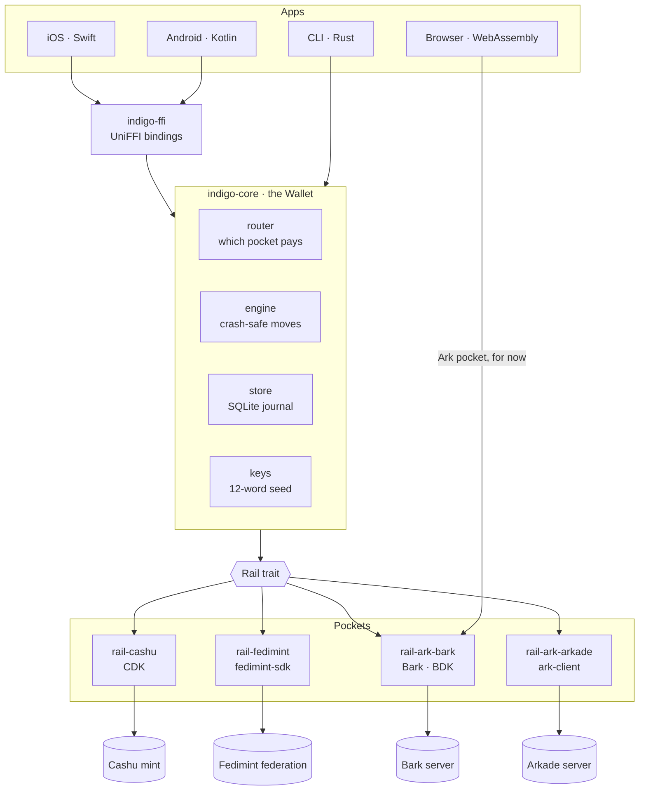
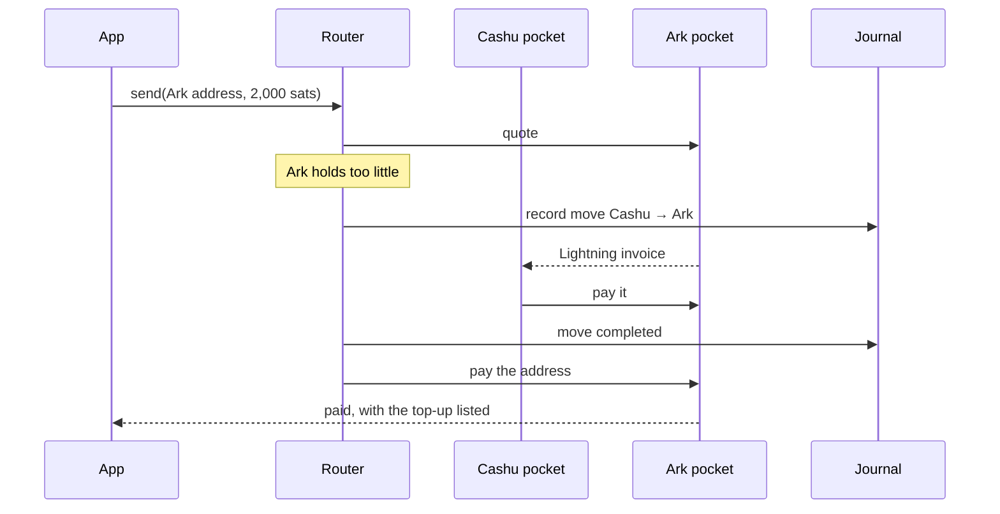

# INDIGO

**One SDK for every Bitcoin layer.**

INDIGO puts Cashu ecash, Fedimint federations, Ark (Bark and Arkade), on-chain
bitcoin and Lightning behind one wallet, with one backup. Developers integrate
it once, through native bindings for iOS and Android or WebAssembly for the
web, and their users get every layer without having to know which one they
are using.

> **Status:** working prototype on test networks (regtest, Mutinynet, Second's
> signet). Not yet audited and not for mainnet funds.

## Why INDIGO

- **One wallet, one backup.** A single 12-word phrase restores every pocket on
  a new device: the mint, the federation and the Ark server are each asked what
  the words own.
- **No pocket picking.** Payments go out from the cheapest pocket that covers
  them. When none does alone, INDIGO moves money into one first, then pays.
- **Every sat accounted for.** Every operation is journaled before it starts
  and recovers from a crash at any step. An audit checks each pocket's balance
  against its journal, to the sat.
- **No central server.** No INDIGO account or kill switch. The developer chooses
  the mints, federations and Ark servers; the recovery words never leave the
  device.

## Quick start

**Requirements:** macOS on Apple silicon, [Rust](https://rustup.rs) 1.85+,
[Docker Desktop](https://www.docker.com/products/docker-desktop/) and Python 3.
For the iOS demo also Xcode, `brew install xcodegen` and
`rustup target add aarch64-apple-ios-sim`.

```sh
demo/start.sh            # start everything; ends with "Ready."
demo/start.sh --fresh    # the same, with both phones starting empty
demo/stop.sh             # stop everything (chain data kept)
demo/stop.sh --wipe      # stop and delete the regtest chain data
```

`demo/start.sh` starts Docker and a local **regtest** network (Bitcoin Core,
LND and Core Lightning, a Cashu mint, a Fedimint federation, an Ark server),
funds it and opens its channels. It then starts the *outside world*
(`demo/outside-world.py`, a faucet and bill issuer on `127.0.0.1:8733`), serves
the web wallet, builds the CLI, and opens the iOS app on two Simulators. It is
safe to run again: only what is down gets started. Logs go to `demo/.run/`.

The five-minute pitch, with what to tap and what to say, is in
[demo/PITCH.md](demo/PITCH.md).

## Demos

All three demos share the regtest network, so the phones, the browser and the
terminal can pay one another.

### iOS

Two people on two phones: **Alice** on *iPhone 16* (iOS 18) and **Bob** on
*iPhone 18 Pro* (iOS 27). Create them if they are missing:

```sh
xcrun simctl create "iPhone 16" "iPhone 16"
xcrun simctl create "iPhone 18 Pro" "iPhone 18 Pro"
```

In each app, type a name and use it freely:

| | |
|---|---|
| **Receive** | A Lightning invoice (INDIGO picks the pocket, or you do), an Ark address, an on-chain address, or redeem ecash |
| **Send** | Paste an invoice or Ark address, or create an ecash note. Any top-up INDIGO made first is listed in the result |
| **⋯ menu** | Test sats, the audit ("Check the books"), the recovery phrase, delete the wallet |
| **Backup** | The 12 words are shown once and three are asked back. "Back up later" is allowed; the app warns once money arrives |
| **Lost phone** | Delete the wallet (typing its name to confirm), then restore from the 12 words: same balance, audit still matches |

The Simulators share the Mac's clipboard, so a code copied on one phone pastes
on the other. Xcode 27's DeviceHub shows one phone per window: `start.sh` opens
two, and you pick *iPhone 18 Pro* in the second.

<details>
<summary>Building the app by hand</summary>

```sh
demo/ios/build-rust.sh     # Rust core → XCFramework, Swift bindings, Xcode project

ALICE=$(xcrun simctl list devices available | grep -F '    iPhone 16 (' | grep -oE '[0-9A-F-]{36}' | head -1)
xcodebuild -project demo/ios/IndigoDemo.xcodeproj -scheme IndigoDemo \
  -destination "id=$ALICE" -derivedDataPath demo/ios/build/app build -quiet
APP=demo/ios/build/app/Build/Products/Debug-iphonesimulator/IndigoDemo.app
for phone in "iPhone 16" "iPhone 18 Pro"; do
  xcrun simctl boot "$phone" 2>/dev/null
  xcrun simctl install "$phone" "$APP"
  xcrun simctl launch "$phone" dev.indigo.demo
done
open -a Simulator 2>/dev/null || {
  open /Applications/Xcode.app/Contents/Applications/DeviceHub.app
  open -n /Applications/Xcode.app/Contents/Applications/DeviceHub.app
}
```

The phone is named by its ID because, by name alone, Xcode looks only in the
newest iOS runtime. The regtest network and the outside world must be running.
</details>

<details>
<summary>Troubleshooting</summary>

- **A spinner that never stops, or "could not reach":** the regtest network or
  the outside world is down. Run `demo/start.sh`.
- **Face ID prompt for the recovery phrase:** Simulator menu → Features →
  Face ID → Enrolled, then Matching Face.
- **Start a phone over:** ⋯ → Delete this wallet, or `demo/start.sh --fresh`.
- **Physical iPhones** are not supported yet: the app reaches the regtest
  network on the Mac at `127.0.0.1`.
</details>

### Web

[http://127.0.0.1:8090/wallet.html](http://127.0.0.1:8090/wallet.html): the Ark
pocket compiled to WebAssembly, its data in IndexedDB. Create or restore a
wallet, receive over Lightning (with a test-faucet button), show its Ark
address, and pay invoices or Ark addresses, including the phones'. Cashu and
Fedimint come to the browser once the journal has a browser store.

Building it needs `brew install llvm`, `wasm-bindgen-cli` and
`rustup target add wasm32-unknown-unknown`; the commands are at the top of
[apps/web-ark-check/src/lib.rs](apps/web-ark-check/src/lib.rs).

### Terminal

```sh
demo/indigo-demo.sh              # press Enter between steps
DEMO_AUTO=1 demo/indigo-demo.sh  # straight through, about two minutes
```

Alice is paid over Lightning into Cashu, moves money into Fedimint and Ark,
boards on-chain coins into Ark, pays a bill, hands Bob ecash, pays Bob over
Ark, and finishes with the audit. The `indigo` CLI behind it exposes every
operation (`target/debug/indigo --network regtest --help`); it reads the
recovery words from `INDIGO_TEST_MNEMONIC` (`indigo new-test-seed` makes some).

## Architecture



| Component | Responsibility |
|---|---|
| **Pockets** (`crates/rail-*`) | One per Bitcoin layer, each implementing the `Rail` trait over the library that layer's own team maintains: balance, Lightning in and out, plus ecash tokens or Ark addresses, boarding and exits. |
| **Journal** (`crates/store`) | Every operation is written to SQLite before any operator is called, and updated as it progresses. The audit compares it with each pocket's balance. |
| **Move engine** (`crates/engine`) | Moves money between pockets over Lightning: the destination issues an invoice, the source pays it. Each step (quoted → invoice → authorized → paying → paid → claimed → completed) is saved before the next call, so a crash at any point resumes or fails cleanly on the next open. |
| **Router** (`crates/router`) | Asks every eligible pocket for a quote and pays from the cheapest that covers the amount, planning top-ups from the others when none does. Incoming payments go to ecash below 100,000 sats and to Ark from there up. |
| **Keys** (`crates/keys`) | One BIP39 seed backs every pocket today, provided by the platform (the iOS app stores it in the Keychain). Per-pocket BIP85 keys and SDK-managed key storage are next. |
| **Bindings** (`crates/ffi`) | Swift and Kotlin via UniFFI, each call on the SDK's own async runtime. The browser build (`apps/web-ark-check`) compiles the Ark pocket to WebAssembly. |

A payment that no single pocket can cover:



**Restore.** From the 12 words alone, Cashu asks the mint for its ecash
(NUT-13), Fedimint rescans the federation and Ark asks its server. What comes
back is recorded in the journal, so the audit matches immediately.

## Testing

With the regtest network running:

| Command | Covers |
|---|---|
| `cargo test --workspace` | Unit tests |
| `tests/phase1.sh regtest` | Cashu pocket, including killing the process mid-operation |
| `tests/phase2.sh regtest` | Fedimint pocket and moves between pockets, killed at every step |
| `tests/phase3.sh regtest` | Ark pocket: boarding, Ark payments, Lightning in and out |
| `tests/phase4-route.sh regtest` | Automatic pocket choice, top-ups and refusals |
| `tests/restore.sh regtest` | Wiping a funded wallet and restoring it from 12 words |
| `tests/web-regtest.sh` | The browser wallet in headless Chrome (needs Node and Chrome) |
| `tests/ios-ui.sh` | The iOS app driven by taps on two dedicated Simulators |

CI (`.github/workflows/ci.yml`) runs the unit tests, the regtest scripts and
the iOS and Android builds.

## Networks

| Network | What runs |
|---|---|
| **Regtest** (local) | Everything: all pockets, on iOS, the web and the CLI. Used by the demos and tests. |
| **Mutinynet** (public signet) | The CLI with Cashu and Fedimint (`infra/mutinynet-setup.sh`) and Ark via the public Arkade server. Covered by `tests/phase1.sh mutinynet` and `tests/phase2.sh mutinynet`. |
| **Second's signet** (public) | The Ark pocket (Bark), natively and in the browser. |

## Repository layout

```
crates/
  domain          amounts, operations, moves and errors
  rail            the Rail trait every pocket implements
  rail-cashu      Cashu pocket (CDK)
  rail-fedimint   Fedimint pocket (fedimint-sdk)
  rail-ark-bark   Ark pocket on Bark; also builds for the browser
  rail-ark-arkade Ark pocket on Arkade
  keys            the recovery seed
  store           SQLite journal
  engine          crash-safe moves between pockets
  router          pocket choice and top-up planning
  core            the Wallet: send, receive, move, restore, audit
  ffi             Swift and Kotlin bindings
  testnets        endpoints of every test network
apps/
  cli             the indigo CLI
  web-ark-check   the browser build and web wallet
demo/             start/stop scripts, the pitch, the terminal demo, the iOS app
infra/            Docker stacks for regtest and Mutinynet, and their setup
tests/            end-to-end test scripts
```

## License

MIT or Apache-2.0, at your option, as declared in `Cargo.toml`.
